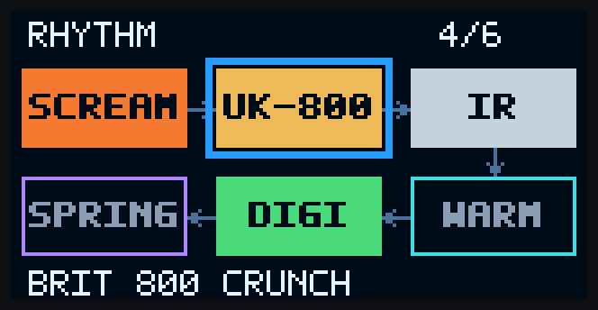
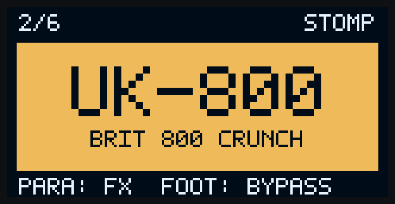
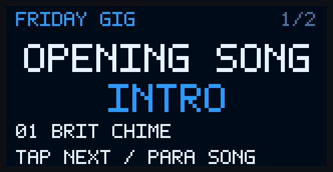
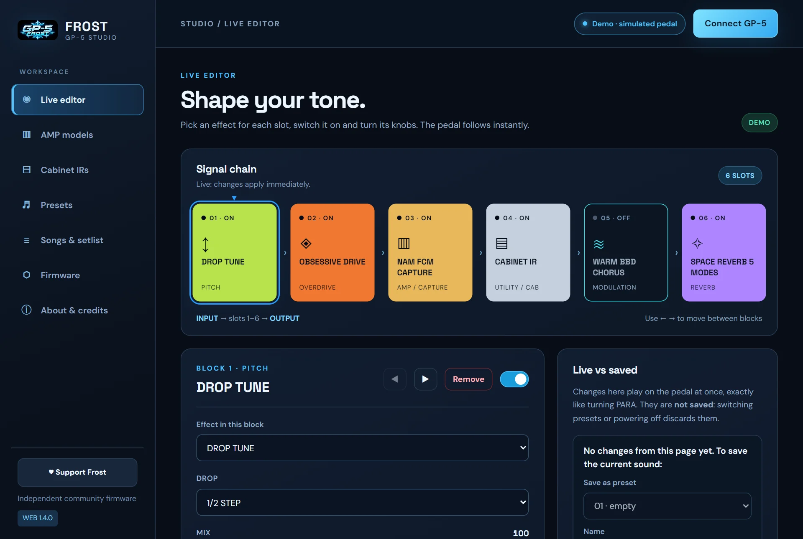

<h1 align="center">Frost</h1>

<b>Custom guitar effects firmware for the Valeton GP-5.</b>

[Installation](docs/Installation%20Guide.MD) · [Pedal guide](docs/User%20Guide.md) · [Effects list](docs/Effects%20list.md) · [Website guide](docs/Website%20Guide.md) · [MIDI commands](docs/Midi%20Command.md) · [Build firmware](docs/Build%20Firmware.md)

## What is Frost?

Frost is alternative firmware for the Valeton GP-5, with an editable signal
chain, amp models, cabinet impulse responses and presets. Shape your sound
with the pedal's controls or use the companion website to edit effects,
manage models and cabinets, and organize songs for performance.

<table><tr>
<td align="center"> Chain: six blocks, input to output</td>
<td align="center"> Stomp: one block, large</td>
<td align="center"> Setlist: songs and parts on stage</td>
</tr></table>

Frost 0.1.0 is the initial preview release for the Valeton GP-5. The installed version is shown
in GLOBAL SETTINGS → SYSTEM → VERSION; release notes come with each release.

## Features

- **Six-slot signal chain:** select effects, adjust parameters, change their
  order and bypass individual blocks.
- **62 effect and amp types:** drives, distortion, dynamics, EQ, modulation,
  delay, reverb, pitch effects, acoustic simulation and eight amp-head voices.
- **Capture models:** convert supported NAM A2 captures into Frost FCM models
  and manage up to 64 model positions through the website.
- **Cabinet IRs:** a built-in cabinet plus 63 custom cabinet positions.
- **60 editable presets:** 20 factory sounds on first use and space for your
  own sounds. Existing Frost presets survive firmware updates.
- **Four home screens:** Chain, Stomp, Preset and Setlist.
- **Songs and setlists:** assign presets to song parts and advance them with
  the footswitch.
- **Tuner and global settings:** tuning reference, input/output levels,
  cabinet override, three-band global output EQ and display preferences.
- **USB MIDI:** preset recall, every effect’s parameters and switches, expression,
  tap tempo, tuner, scene masks, global bypass and incoming MIDI Clock.
  See the [MIDI guide](docs/Midi%20Command.md) for mappings and USB host requirements.
- **USB audio:** stereo 16-bit 44.1 kHz recording/playback and a saved Direct
  Monitoring switch. DAW/backend compatibility remains under test.
- **Bluetooth MIDI:** receive BLE MIDI with a saved Bluetooth on/off switch.
  Phone/computer music streaming is not implemented.
- **Browser tools:** live editing with named model/cabinet selectors, a shared
  **NAMs & IRs** library with import, rename and download, preset management
  and patch loading, backups and USB firmware installation.

Frost plays converted capture approximations; it does **not** run native NAM.
Heavy chains can exceed the DSP budget. Preset changes do not provide
effect-tail spillover. Recall fades through a silent gap; changed custom IRs
still take time to load. Storage writes can briefly interrupt audio.
The latest transition changes have passed focused device telemetry checks,
but click-free switching and professional live use remain unqualified.

The release firmware includes **USB audio and Bluetooth MIDI** alongside all
effect, preset and IR changes; see the [build guide](docs/Build%20Firmware.md).
It adds stereo 16-bit recording/playback at 44.1 kHz and BLE MIDI control.
Short device checks cover USB recording/playback and BLE MIDI reception.
USB audio/BLE remains experimental; long-session stability and heavy-chain load
still need qualification. Bluetooth phone-audio streaming is not implemented.

## Getting started

1. Follow the [Installation Guide](docs/Installation%20Guide.MD) to back up
   your sounds and install the matching firmware file.
2. Read the [User Guide](docs/User%20Guide.md) for controls, presets, tuning
   and performance workflows, and the [Effects list](docs/Effects%20list.md)
   for every effect and amp.
3. Open [Frost Studio](https://freelender.github.io/frost-gp5/) and follow the
   [Website Guide](docs/Website%20Guide.md) to connect and manage your pedal.

 Editor: preset selection, named captures and live controls (documentation demo with synthetic names)

Developers: see [Build Firmware](docs/Build%20Firmware.md) and
[CONTRIBUTING.md](CONTRIBUTING.md).
To write a custom effect, follow [Build an effect](docs/Build%20effect.MD).

## License

Frost is licensed under the [MIT License](LICENSE). Adapted components retain
their notices in [THIRD_PARTY_NOTICES.md](THIRD_PARTY_NOTICES.md).
Private captures, user IR files, compiler archives and stock firmware are not
distributed as source. Valeton and GP-5 are trademarks of their respective
owners; Frost is an independent project. Frost's effect and amp models use
their own names; the products that inspired them are listed in the
[Effects list](docs/Effects%20list.md) only to describe their sound.
All such names are trademarks of their respective owners, who are not
affiliated with or endorsing Frost.

Pedal screen images are rendered from the firmware's own display code;
website images use a local documentation demo with synthetic preset, capture
and cabinet names. They do not show a connected pedal or measured audio results.

## Support the project

If Frost is useful to you, you can help support its development:

**[Support Frost on Ko-fi](https://ko-fi.com/freelender)**

## Credits

Frost builds on **[OpenGP5](https://github.com/OpenGP5/OpenGP5)**. Thank you to
its contributors for the GP-5 platform, hardware interfaces, USB firmware
tools and shared research that made Frost possible.

Thanks also to everyone testing Frost and reporting reproducible issues.
