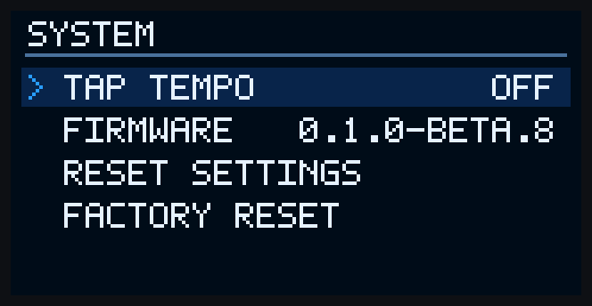

# Installation Guide

Install Frost on a **Valeton GP-5** through USB. You do not need to build the
source if you have a supplied firmware file.

## 1. Prepare

You need a powered GP-5, a USB **data** cable, desktop Chrome or Edge, and
the matching Frost `.bin` extracted from your release/tester ZIP.
Open [Frost Studio](https://frost.fretlexwins.workers.dev/).

Frost replaces the pedal's application firmware. Keep your sounds backed up
and read the recovery steps below before installing.

**Before you switch:** Frost does not support the GP-5's **USB audio
interface** or **Bluetooth** yet. While Frost is installed you cannot record
or play audio over USB, or stream backing tracks over Bluetooth. Reinstall
Valeton's firmware to use them again.

## 2. Back up your sounds

1. For stock Valeton firmware, use Valeton's editor to back up stock presets.
2. For an existing Frost installation, connect in Frost Studio, open
   **Presets → Back up everything**, and keep the `.frostbackup` file.
3. Keep stock and Frost backups separately; they are different formats.

Firmware updates preserve existing Frost storage. Backups do not include
unsaved live edits, so save those to a preset first.

## 3. Connect

1. Turn listening volume down and power the GP-5 normally.
2. Connect the pedal directly to the computer with the data cable.
3. Close other pedal editors and browser tabs using the GP-5.
4. Open Frost Studio and allow MIDI/SysEx access when asked.

If no MIDI device appears, check browser permission and try another cable or
USB port. Charge-only cables cannot transfer firmware.

## 4. Choose the firmware

1. Open **Firmware** in the website sidebar.
2. Click **Drop a firmware .bin**, or drag the extracted `.bin` into the box.
3. Read the detected version and section list before proceeding.

Each release comes with its `.bin`, release notes and a `SHA256SUMS.txt` file
with the firmware's checksum. After installing, check that GLOBAL SETTINGS →
SYSTEM → VERSION shows the version of the release you installed.

A custom source build has its own checksum. Use its build manifest and do
not assume it matches the supplied image. A ZIP, `.nam`, WAV or backup is
not a firmware file.

Some website releases offer a bundled **Install Frost** button. If it is
unavailable, choose the supplied local `.bin`; separate-file beta delivery
does not require a firmware download on the site.

## 5. Install

1. Click the install button for your selected image.
2. Read and approve the confirmation for the intended GP-5.
3. Leave power and USB connected. Update mode is entered automatically when
   possible. Allow around 90 seconds for the complete image.
4. Wait for completion and the pedal's restart.
5. Reconnect in the website; reload the page if needed.

The Frost image contains DSP, DSP-data and controller app sections. It does
not replace the Frost user-preset/model-storage area. Do not unplug during
transfer. If only reconnection fails, inspect the pedal first rather than
immediately repeating a completed flash.

## 6. Check the result

1. Hold **PARA** on a home screen to open GLOBAL SETTINGS.
2. Open **SYSTEM** and find **VERSION**. It shows the installed version.
3. Choose **BACK** to leave the menu, then **BACK** again to leave Settings.

 GLOBAL SETTINGS → SYSTEM shows the installed firmware version

4. At low volume, select a preset and play through the normal audio output.
   USB is used here for control and file transfer.
5. Try a patch with IR enabled, then change Chain → Preset and Preset → Chain.
   Confirm audio resumes after saving the home-screen setting.

First use with empty Frost storage supplies 20 editable factory presets.
An existing Frost bank is retained. A firmware update does not need a factory
reset; that reset erases user data.

## Recovery

1. Disconnect pedal power.
2. Hold the **footswitch and PARA knob** while reconnecting power to enter
   the factory update mode.
3. Keep USB connected, open the website's Firmware page and choose the
   intended firmware file.
4. Install again and wait for completion. Check power, cable and other MIDI
   applications if communication fails.

To return to stock, obtain the correct official GP-5 image from Valeton and
choose it in the same installer. Stock firmware is not distributed here.
Use your stock backup with the stock editor; a Frost backup is not converted
into Valeton presets by changing firmware.

## Troubleshooting

| Problem | Check |
|---|---|
| No pedal listed | Desktop Chrome/Edge, data cable, MIDI permission and competing editors closed |
| File rejected | Extract the ZIP and select its GP-5 `.bin`; copy/download again if corrupted |
| Old website information | Hard reload with Ctrl+Shift+R and select the file again |
| Interrupted update | Use the factory update-mode procedure above |
| "Refused the erase" (error code 01) every time, nothing written | Unplug and reconnect: the pedal keeps its current firmware. If Valeton's own updater also fails (Valeton Suite stays at 0 %), see [DSP updater fault](#dsp-updater-fault) |
| "Did not answer the erase" (no answer), nothing written | Unplug and reconnect, then retry with another data cable, no hub and other MIDI applications closed. If it happens every time, see [DSP updater fault](#dsp-updater-fault) |
| Transfer finished, reconnect failed | Check the pedal, reconnect USB and reload before considering another update |

## DSP updater fault

Some GP-5s have a fault in the updater of their audio processor (the DSP).
It blocks **every** firmware update, Valeton's included. It is a fault of
the pedal, not of Frost, and it was found and fixed by the OpenGP5 project.

**Symptoms** (all of them):

- The install stops at the erase of the first DSP section (`dsp`), before
  anything is written: "refused the erase" or "did not answer the erase".
- It happens every time, with every tool. Valeton Suite stays at 0 %.
- Unplugging and reconnecting the pedal starts its current firmware again.

**Fix:** follow OpenGP5's [J7 recovery](https://opengp5.github.io/docs/platform/j7-recovery/).
In short:

1. Open the pedal and connect an **FT232H** USB board to the **J7** header
   next to the DSP chip (three wires).
2. Get the stalled updater moving for one session with OpenGP5's tools.
3. Install an OpenGP5 build that supports `tickfix` (for example its tremolo).
4. Apply the permanent four-byte fix with `gp5tool.py tickfix --apply`.
5. Install Frost through the website as usual. Later updates, Frost's and
   Valeton's, then work without the adapter.

Opening the pedal and wiring J7 is at your own risk: a wiring mistake can
damage it. Frost cannot apply the fix itself. If you are not comfortable
with this, keep Valeton's firmware. Please report the result, and the
pedal's purchase date, so we can track which units are affected.

Next: [User Guide](User%20Guide.md) · [Effects list](Effects%20list.md) · [Website Guide](Website%20Guide.md).
