

# Frost for Valeton GP-5 — User Guide

Website: [Frost GP-5 Studio](https://frost.fretlexwins.workers.dev/)

Frost provides a six-slot signal chain, amp heads, converted capture models,
cabinet IRs, editable presets, a tuner, and songs/setlist navigation. Once your
sounds and setlist are saved, the pedal works without the website connected.

**Not supported yet:** with Frost installed, the GP-5 does **not** work as a
USB audio interface (no recording or playback over USB) and **Bluetooth is
off** (no streaming of backing tracks from a phone). USB carries only MIDI for
the website and controllers. Valeton's own firmware keeps both features;
reinstall it if you need them.

## 1. Get started

Install the supplied firmware using the [Installation Guide](Installation%20Guide.MD). Connect your
guitar and normal audio output, starting with a low output volume. USB is used
by the website for pedal control and file transfers; listen through the pedal's
normal audio output and your headphones, interface, amplifier or powered speaker.

For website editing, use desktop Chrome or Edge. Open the website, connect the
powered GP-5 using a USB data cable, and click **Connect GP-5**. Allow MIDI,
including SysEx messages, when the browser asks. Close other pedal editors or
browser tabs using the device.

**Try the demo** lets you explore the live editor without changing a pedal.

## 2. Pedal controls

| Control | Normal use |
|---|---|
| PARA turn | Select a block, menu row, preset or song, depending on the screen |
| PARA short press | Open the selection or enter/leave a value edit |
| PARA hold on a home screen | Open Global settings |
| Footswitch tap on a home screen | Bypass the selected block (or toggle assigned effects in CTL mode), advance a preset, or advance a setlist part, depending on the home screen |
| Footswitch tap in a menu | Go back one level (same as **BACK**) |
| Footswitch hold | Open the tuner; Setlist view can instead use Previous Part. With TAP TEMPO → TAP TEMPO ON, on a tempo effect (Chain or Stomp view): a tap sets the tempo and a hold switches the effect on/off |

In parameter menus, turn to select a row, press to edit it, turn to change its
value, then press again to leave the value edit. Use **BACK** or tap the
footswitch to return one level. A parameter value is kept as you turned it;
an unconfirmed TYPE, POSITION, CAB or REMOVE choice is cancelled. In Global
settings the footswitch leaves a value edit, and from the settings list it
saves and returns home like **BACK**. Use the effect’s **ACTIVE** row to switch it on/off from this menu, or use
the footswitch on its home screen. ACTIVE edits apply as you turn PARA; press
again to leave the edit. Save the preset to keep the on/off state.
Some effects have their own momentary footswitch behavior on home screens.

<table><tr>
<td align="center">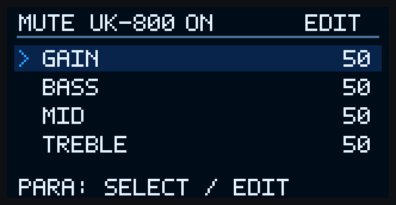 PARA press: the block's parameters</td>
<td align="center">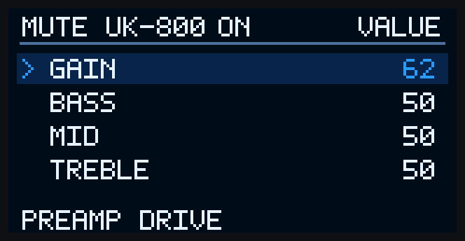 Press again: edit the value (blue)</td>
</tr></table>

### Control several effects with CTL

In GLOBAL SETTINGS → DISPLAY → **FOOTSWITCH**, choose **SELECTED** (default)
or **CTL**. SELECTED keeps the usual selected-block footswitch behavior.
CTL lets a Chain/Stomp footswitch tap toggle several effects in the current patch.

Open each effect with PARA, select **CTL**, press to edit, choose **ENABLE**
or **DISABLE**, and press to confirm. Every effect starts with CTL **DISABLE**,
including effects in older presets. Save the preset to keep its assignments.
Assignments stay with a block when reordered; a replacement effect starts disabled.

In CTL mode, a short tap toggles each assigned effect from its current state:
on becomes off, and off becomes on. For example, an enabled drive and bypassed
delay exchange states together; another tap restores them. Unassigned effects
keep their state. An empty CTL group does nothing. Loading a preset restores
its saved on/off states and assignments. The footswitch light is on when any
assigned effect is on.

CTL takes priority over footswitch tap tempo and the selected effect's
momentary footswitch modes on Chain/Stomp. A hold opens the tuner without
toggling the group. Preset and Setlist screens keep their navigation gestures,
and the footswitch still goes back in menus. MIDI tempo controls remain available.

### Tap tempo with the footswitch

Tap tempo is **off** by default: the footswitch then works as described above.
Turn it on in GLOBAL SETTINGS → TAP TEMPO → **TAP TEMPO**. That menu also holds
TAP NOTE, TAP TARGET and TEMPO LIGHT (see [section 8](#8-global-settings-and-tuner)).

Tempo effects are the delays (DIGI, BBD, DELAY, TAPE) and the modulation
effects with a rate in Hz (for example TREM, H-TREM, VIBE, WARM, PHASE). With
one of them selected on the Chain or Stomp screen:

- **Tap** the footswitch on the beat. The first tap opens the **TAP TEMPO**
  popup with the effect's current tempo in BPM and time in ms; from the second
  tap on it shows the tapped tempo. Taps never switch the effect. The popup
  closes 2.5 seconds after the last tap.
- **Press and hold** the footswitch (about half a second) to switch the effect
  on or off. On a tempo effect the hold does not open the tuner.

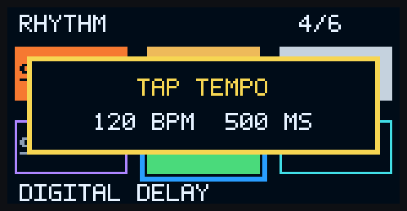 TAP TEMPO popup: four taps at 120 BPM set a 500 ms delay

The tempo is the average of your last taps (30–300 BPM); a very different tap
starts a new average, and a pause over 2 seconds starts over. GLOBAL SETTINGS
→ TAP TEMPO → **TAP NOTE** chooses what a delay repeats on: a quarter note, a
dotted eighth or an eighth. Modulation runs one cycle per that note. Values
outside an effect's range are clamped (BBD reaches at most 300 ms). The tapped
value is a normal edit: save the preset to keep it.

**TAP TARGET** chooses which effects a tap sets:

- **SELECTED** (default): only the selected effect.
- **GLOBAL**: every tempo effect in the chain at once, for example a delay
  and a tremolo together. The popup then reads **GLOBAL TAP TEMPO**.

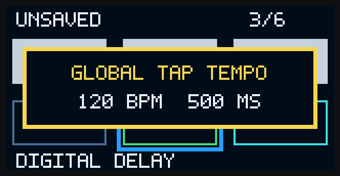 GLOBAL TAP TEMPO popup: 120 BPM sets every tempo effect

In both modes you tap with a tempo effect selected, and a hold switches only
the selected effect on or off. With a non-tempo block selected, the footswitch
works as usual. A MIDI controller can also tap the global tempo; see
[Tap tempo and MIDI Clock](Midi%20Command.md#tap-tempo-and-midi-clock).

While a tempo effect is on, the footswitch light flashes **yellow** on the
beat: on its usual mint colour, or on blue while the TAP TEMPO popup is open. An
effect that is off stays dim red. GLOBAL SETTINGS → TAP TEMPO → **TEMPO LIGHT**
turns the flashing off. On any other effect the footswitch works as usual (a
press switches it, a hold opens the tuner); select a non-tempo block first to
open the tuner.
DIGI with FOOT=HOLD and WARBLE with MODE=UNLATCH keep their own footswitch
behavior.

### Choose a home screen

Hold PARA on a home screen, open **DISPLAY**, select **HOME SCREEN**, press,
choose a view, then press again. Go back to GLOBAL SETTINGS and choose **BACK**
to save and return.

| Home screen | PARA turn | Footswitch tap |
|---|---|---|
| CHAIN | Select an effect block | Toggle the selected block |
| STOMP | Select an effect; show it prominently | Toggle the selected block |
| PRESET | Load previous/next stored preset | Load next stored preset; wraps at the end |
| SETLIST | Select previous/next song and load its first part | Advance to the next part |

<table><tr>
<td align="center">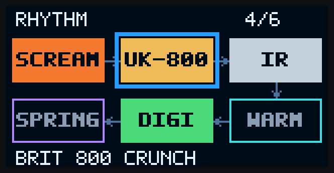 CHAIN: filled blocks are on, outlined blocks are bypassed</td>
<td align="center">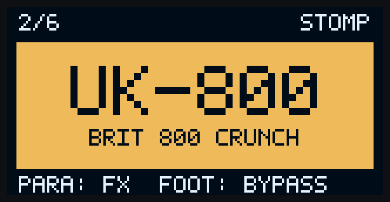 STOMP: the selected block, large</td>
</tr><tr>
<td align="center">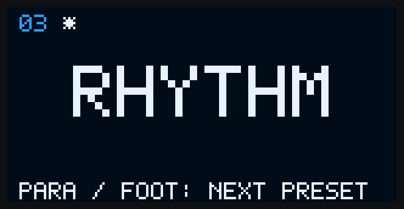 PRESET: number and name (* = edited)</td>
<td align="center">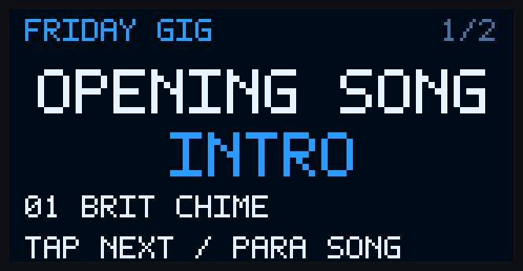 SETLIST: setlist, song, part and its preset</td>
</tr></table>

From CHAIN or STOMP, press PARA to open the selected effect's parameters.
From PRESET or SETLIST, press PARA to open the chain for editing. These views
return from the chain to the selected home screen after about 15 seconds idle.

## 3. Build and edit a sound

The signal runs from input through slots 1–6 to output. Empty slots do not
process the sound. One typical electric-guitar chain is:

**Compressor → Overdrive → Amp head → IR → Delay → Reverb**

On the pedal, select a block and press PARA. Use **TYPE** to choose its effect,
**POSITION** to move it in the signal order, and **REMOVE** to clear it after
confirmation. Effect parameter rows control its sound.

On the website, open **Editor**, select a block, and use its inspector to
change the effect, bypass state and available parameters. **Replace effect**
opens the Effects library; an empty block shows **Add Effect**. Changes affect
the sound immediately, but they are **not saved to a preset** until you use
**Save to pedal** in the Editor or save on the pedal itself. Selecting another
preset or switching off discards unsaved edits. The selector above the chain
shows the current preset; its arrows load the previous/next saved preset,
and clicking its name opens preset search.

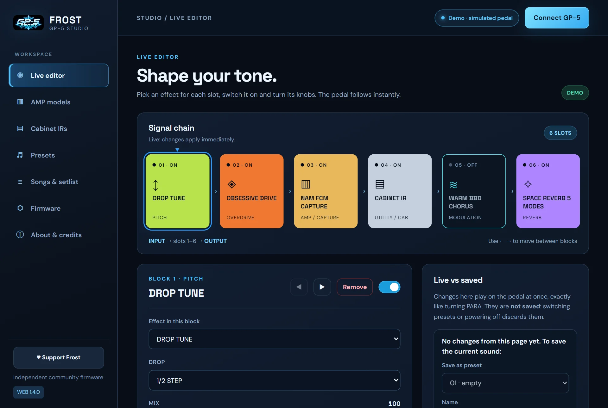 Website Editor (local documentation demo with synthetic names)

There are six slots, but processing capacity depends on the effects chosen.
AMP plus five effects is the design target, not a guarantee for every heavy
combination. A second amp or unsupported combination can be refused. If a chain
overloads, simplify it or select a lighter preset.

Effects also share a fixed amount of effect memory on the audio processor.
Most chains fit, but several of the largest effects together (NAM capture,
OBSESS, OCTAVE, an amp head, ENVWAH, MOUSE) may not. The pedal then refuses the change
and shows **CHAIN TOO BIG**: the previous chain keeps playing, and a preset
that does not fit is not loaded. Replace one of the larger effects.

The pedal also estimates the processing load of a chain before it plays, from
costs measured for each effect while playing guitar. A chain estimated above
about 90% of the DSP is refused with **DSP LIMIT**, so it does not overload,
crackle or mute. The heaviest effects are OCTAVE (about 52% on its own), NAM
capture (about 32%), the UK-800, CALI and BROWN heads (about 29%) and the
reverbs (REVERB 25%, SPRING 24%). SPACE depends on its MODE: ROOM and HALL
about 23%, PLATE 29%, MOD 35% and SHIMMER 38%. Changing SPACE to a costlier
MODE on a full chain is refused with DSP LIMIT and the old mode keeps
playing. Both refusals appear as a popup for about 2.5 seconds.

### Delay and reverb tails

DIGI, BBD, TAPE, PING, SPACE and SPRING have a **TAIL** setting (OFF by default):

- **TAIL OFF:** switching the effect off fades it out within a few
  milliseconds. While it is off it uses no DSP, and when you switch it on
  again it starts fresh, without echoes of what you played meanwhile.
- **TAIL ON:** switching the effect off stops feeding it your playing, but the
  echoes or reverb already in it keep ringing out naturally. Once the tail has
  died away, the effect rests and uses no DSP.

TAIL is saved with the preset. The generic DELAY and REVERB behave as TAIL OFF.
On a preset change, tails are cut with the usual short crossfade.

### Stereo and the ping-pong delay

The GP-5 has a stereo output. With **GLOBAL SETTINGS → AUDIO → OUTPUT MODE**
set to **STEREO**, the **PING** delay bounces its echoes between the left and
right outputs; **WIDTH** sets how far (0 = the same echoes on both sides).
Everything else in the chain stays mono, so stereo costs no extra DSP until a
stereo effect plays.

- With OUTPUT MODE **MONO**, PING is an ordinary delay with every echo at full
  level, so it sounds right through a single amp or speaker.
- Put PING near the end of the chain, after the amp and cab. Delays, reverbs
  and modulation may follow it and keep the stereo spread. If an amp, drive,
  cab, pitch or dynamics block comes after PING, it plays mono (the stereo
  echoes would skip that block otherwise); move PING after it to get stereo.
- PING's TIME is the time between echoes, up to 400 ms: each side repeats at
  twice that.

### Read the DSP meter

The DSP percentage on the Chain screen shows a **recent peak**, rather than
an average. It updates every 2.5 seconds. A preset change includes loading,
resetting effect histories and fading between sounds, so a brief switching
spike can remain on the meter for several seconds. Repeated preset changes
can keep that peak visible even when the settled presets run below 100%.

Above 100% means at least one measured audio block exceeded its processing
budget. Let the preset settle before judging its normal load. A brief high
reading alone does not mean the preset stays overloaded, but clicks or short
noise during the change are still switching issues worth reporting. If the
reading stays high while playing one preset, simplify the chain and report
the preset and effects used. Include whether the noise happens only during
switching or continues afterwards.

## 4. Amp heads and capture models

The algorithmic amp heads are Frost's own models, inspired by these familiar
amp styles (trademarks of their owners; see the notice in the [Effects list](Effects%20list.md)):

- US-DLX: Fender '65 Deluxe Reverb
- US-DBL: Fender Twin Reverb
- CHIME: Vox AC30 Top Boost
- JAZZ: Roland JC-120
- UK-800: Marshall JCM 800
- CALI: Mesa/Boogie Dual Rectifier
- BROWN: EVH 5150
- SL-100: Soldano SLO-100

### SL-100 channels

SL-100 has three channels on its **MODE** control:

- **CLEAN:** one gain stage, open and glassy; stays clean at moderate GAIN.
- **CRUNCH:** two stages, mid-forward rock crunch.
- **LEAD:** three cascaded stages with a tight low end, for singing leads.
- **CLEAN BRT / CRUNCH BRT:** the same channels with the bright cap on, a
  treble lift that is strongest at low GAIN and fades as GAIN rises (as on
  the real amp; LEAD has none).

At the default settings LEAD and CRUNCH play about as loud as UK-800 and
CLEAN about 2 dB quieter, so switching channels in a preset needs little
LEVEL change. The power amp's low-end resonance is set per channel: more
thump on LEAD, less on CLEAN. Add an IR block after it, as with every head.

### Single coils and humbuckers

The factory presets and amp voicings are balanced for a medium-output guitar.
Single-coil pickups put out less signal, so high-gain amps (UK-800, CALI,
BROWN, SL-100 LEAD) and drives sound cleaner and thinner, and clean patches quieter.
Humbuckers put out more, so cleans break up sooner.

The high-gain heads cut deep bass before their gain stages and restore it
afterwards, like the amps that inspired them, so neck pickups stay tight on
power chords and triads. If a neck pickup still sounds woolly, lower BASS on
the amp rather than INPUT GAIN on every preset.

Match your guitar once with GLOBAL SETTINGS → AUDIO → **INPUT GAIN**, rather
than raising GAIN on every preset:

| Guitar | Try INPUT GAIN |
|---|---|
| Vintage-style single coils (Strat, Tele) | +3 dB; up to +6 dB for cleans and drives |
| Hot single coils, P-90s | 0 to +3 dB |
| Medium humbuckers | 0 dB |
| High-output or active humbuckers | -3 to -6 dB |

A quick check: on the Deluxe Clean preset, a hard strum should just begin to
break up.
INPUT GAIN affects every preset and is saved with your global settings.

These are **amp heads only**. Use a separate IR block for the cabinet when
listening through headphones, an audio interface or a full-range speaker.
With a physical guitar cabinet, choose whether to bypass the IR for your setup.

Drive/gain affects distortion; master and level affect the amp's response and
output balance. As a starting point for a newly added US-DLX or CHIME block,
MASTER 60 and LEVEL 57 are the current defaults. High-gain models may need
different levels. Match sounds by listening rather than copying knob values.

The block labelled **NAM** uses Frost FCM capture models. Frost converts
supported NAM A2 captures into approximations; it does not run native NAM.
BASS, MIDDLE and TREBLE adjust the model output by -12 to +12 dB, with
0 dB neutral. They are saved per preset and do not change the capture file.

### Add a capture model

1. Open **NAMs & IRs → Amp models → Add model** on the website.
2. Choose a supported `.nam` capture or a ready-made `.fcm` file.
3. For a NAM conversion, optionally choose the recommended training `input.wav`
   described on the page. Click **Convert** and allow a few minutes.
4. Choose a name and MODEL number, then click **Write to pedal** and confirm.
5. Choose **Use in this block** when offered, or select the model by name in
   the Editor's NAM **MODEL** dropdown. Save the preset on the website or pedal.

MODEL 00 is built in; MODEL 01–63 are user model positions. Conversion quality
depends on the capture. Replacing a model number changes all presets using it.

To rename a stored capture, find it in **NAMs & IRs → Amp models**, click
**Rename**, edit the prefilled name (up to 15 characters), and choose **Save**
or **Cancel**. Renaming keeps its MODEL number and audio data, so existing
presets keep using it. **Add a model…** in the Editor's MODEL dropdown opens
the import form directly.

## 5. Cabinet IRs

An IR adds the frequency response of a captured cabinet/microphone setup. It
does not replace an amp head. Place IR after the amp for a typical direct tone.

- **CAB 00:** the built-in cabinet. Release firmware uses "Cookie Monster"
  from the Jesters Brutal Pack (CC0, credited in THIRD_PARTY_NOTICES.md);
  custom source builds may use a different cabinet or the synthetic diagnostic FIR.
- **CAB 01–63:** custom cabinets written from the website.
- **VOL 80:** default for a newly added IR block; adjust by ear for your chain.
- **LOW CUT:** removes low end below the set frequency (12 dB/octave),
  10–400 Hz. **0 HZ** is off (the default).
- **HIGH CUT:** removes treble above the set frequency (12 dB/octave),
  1,000–19,750 Hz. **20000 HZ** is off (the default).

Presets saved before these controls existed load with both cuts off and sound
unchanged. LOW CUT and HIGH CUT act on the cabinet sound before VOL and the
bypass fade.

### Add and select a cabinet

1. Open **NAMs & IRs → Cabinet IRs → Add cabinet** and choose a cabinet
   `.wav` file.
2. Choose a name and CAB number, then **Write to pedal** and confirm.
3. Choose **Use in this block** when offered, or open the IR block in the
   Editor and select its name in **CAB**. On the pedal, select its CAB number.
   Uploading a file alone does not select it in the active chain.
4. Save the preset on the website or pedal to retain the CAB selection and IR settings.

The cabinet list also offers **Rename**: edit its prefilled name and choose
**Save** or **Cancel**. This preserves its CAB number, audio data and preset
references. **Add a cabinet…** in the Editor's CAB dropdown opens the import
form directly. Names are limited to 15 characters.

The website converts supported WAV files to a mono, 44.1 kHz, 512-tap response.
Long reverberation tails are not retained as a full room impulse response.
Replacing a CAB number changes every preset referencing it. If a referenced
custom cabinet is missing, Frost uses the built-in cabinet until it is replaced.

If IR seems bypassed, check that the block is enabled and Global **CAB OVERRIDE**
is OFF. If the tone is quiet, check amp level, IR VOL, Global OUTPUT LEVEL and
the physical volume control before adding more gain everywhere.

## 6. Save and manage presets

Frost has **60 editable preset slots**. On first use with empty Frost preset
storage, slots 01–20 receive factory sounds and 21–60 remain empty. Factory
sounds use ordinary slots: rename, overwrite or delete them to use all 60 for
your own sounds. Updating firmware preserves an existing Frost bank.

### Save the current sound

1. Finish editing on the pedal or website.
2. On the pedal, open a block's parameters and select **PRESETS**. The list
   opens on the preset you are playing, marked with `*`.
3. To keep the preset's number and name, turn PARA one step back to the top
   row, **SAVE CURRENT PRESET**, and press PARA. It saves at once.
4. To save under another number, choose that number, press PARA, select
   **SAVE** and press PARA again. Saving to an occupied number replaces it.

SAVE CURRENT PRESET is greyed out until a preset has been loaded or saved. To
load through this menu, choose the preset number, press PARA, select **LOAD**
and press again. PRESET home offers quicker footswitch/PARA navigation.

The website's **Presets** page can rename, reorder and delete stored presets.
To store Editor changes from the website, choose **Save as preset**, enter a
name and click **Save to pedal**. Confirm the destination; an occupied number
is replaced. The on-pedal SAVE workflow remains available.

The pedal remembers the preset you are on and starts with it after a power
cycle. It stores your choice once you have stayed on a preset for about two
seconds and stopped playing for a moment, because saving briefly interrupts
the cabinet IR. Quickly browsing through presets stores only the one you stop
on. Unsaved edits are not kept: SAVE the preset to keep them.

### Factory sounds

| Slot | Preset | Slot | Preset |
|---|---|---|---|
| 01 | Acoustic | 11 | Classic Crunch |
| 02 | Deluxe Clean | 12 | Arena Rock |
| 03 | Twin Sparkle | 13 | Brown Crunch |
| 04 | Jazz Club | 14 | Modern Rhythm |
| 05 | Nashville Snap | 15 | Tight Metal |
| 06 | Brit Jangle | 16 | Singing Lead |
| 07 | Edge of Chime | 17 | Fuzz Sunset |
| 08 | Blues Breakup | 18 | Liquid Vibe |
| 09 | Texas Drive | 19 | Funk Filter |
| 10 | Vintage Trem | 20 | Ambient Bloom |

Acoustic uses compression, acoustic simulation and reverb, without an amp head
or electric cabinet. Factory reverb mix/effect level stays at or below 25%.
Factory amp master and output levels are set individually for each sound;
your guitar and playing can still produce differences. Vintage Trem starts
with Classic Tremolo at 2.10 Hz. Updated factory settings apply when an empty
bank is initialized; firmware updates preserve your existing saved presets.

## 7. Songs and setlists

A song contains named parts such as Intro, Verse and Chorus. Each part refers
to an existing preset number. A setlist arranges songs in performance order.

1. Save the presets you want to use first.
2. Open **Setlists** on the website. If preserving an existing pedal
   setlist, use **Read from pedal** before editing your draft.
3. Create a song, name its parts, and assign a preset number to each part.
4. **Add the song to the setlist order.** A song in the library alone will not
   appear in the pedal's performance setlist.
5. Name the setlist, arrange the songs, and choose **Save to pedal**. Confirm
   and wait for the transfer and display refresh to finish.
6. On the pedal, choose Global **HOME SCREEN → SETLIST**, then **BACK**.

The display shows the setlist, song position, song, part and referenced preset.
Tap the footswitch to advance a part. From a song's last part, the next tap
loads the next song's first part. It stops at the end of the setlist.

Global **SETLIST HOLD** chooses **PREV PART** (default) or **TUNER**. Previous
part crosses song boundaries and stops at the beginning. Turning PARA selects
songs. Rebooting in Setlist view starts at the first part of the first song.

There is one active setlist on the pedal. Use JSON export/import on the website
to keep alternatives on your computer. Browser drafts are separate from pedal
storage and are not transferred until you save.

The limits are up to 64 library songs, 16 parts per song and 64 performance
entries, subject to shared storage. For example, 44 songs with four parts or
32 songs with six parts fit. The website checks the storage limit.

Parts reference slot numbers, not copies of presets. Moving, deleting or
replacing a preset changes what referencing parts play. Check your setlist
after reorganizing presets. Preset changes reset effect histories; delay and
reverb tails do not spill over. Avoid editing/writing storage while performing,
as saving can briefly interrupt audio.

## 8. Global settings and tuner

Hold PARA on a home screen to open **GLOBAL SETTINGS**. It lists four
menus: **AUDIO**, **DISPLAY**, **TAP TEMPO** and **SYSTEM**. Turn to select a row and press to
open a menu or edit a setting; turn to change the value and press again.
**BACK** (or the footswitch) goes up one level; BACK in GLOBAL SETTINGS saves
and exits.

<table><tr>
<td align="center">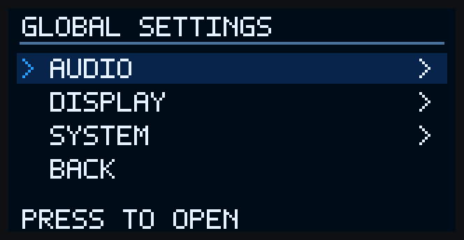 GLOBAL SETTINGS: AUDIO, DISPLAY, TAP TEMPO and SYSTEM</td>
<td align="center">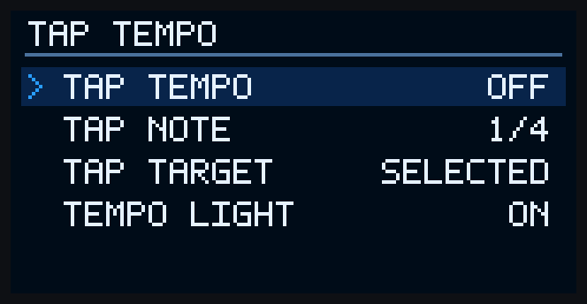 TAP TEMPO: on/off, note, target and tempo light</td>
</tr></table>

| Menu | Setting | Purpose |
|---|---|---|
| AUDIO | INPUT GAIN | Adjust input level from -20 to +20 dB; match your pickups (single coils about +3 to +6 dB, see section 4) |
| AUDIO | OUTPUT LEVEL | Scale overall output, 0–100% |
| AUDIO | OUTPUT MODE | MONO sends the same signal to both outputs. STEREO lets stereo effects (PING) spread across the left and right outputs; everything else stays mono |
| AUDIO | CAB OVERRIDE | ON bypasses IR blocks globally without changing presets |
| AUDIO → GLOBAL EQ | GLOBAL BASS / MIDDLE / TREBLE | Three-band output EQ, -12 to +12 dB; 0 dB is flat |
| DISPLAY | HOME SCREEN | Choose CHAIN, PRESET, STOMP or SETLIST |
| DISPLAY | BRIGHTNESS | Adjust screen brightness |
| DISPLAY | FOOTSWITCH | SELECTED (default): selected-block behavior. CTL: tap toggles the current preset’s CTL-enabled effects on Chain/Stomp |
| DISPLAY | SETLIST HOLD | Choose previous part or tuner for a Setlist footswitch hold |
| TAP TEMPO | TAP TEMPO | OFF (default): usual footswitch. ON: on a delay or modulation effect, taps set the tempo and a hold switches it on/off; the light flashes on the beat |
| TAP TEMPO | TAP NOTE | The note a tap sets: 1/4 (default), DOTTED 1/8 or 1/8. Also applies to MIDI tap and MIDI Clock |
| TAP TEMPO | TAP TARGET | SELECTED (default): a footswitch tap sets the selected effect. GLOBAL: it sets every tempo effect in the chain |
| TAP TEMPO | TEMPO LIGHT | With TAP TEMPO ON: ON flashes the footswitch light yellow on the beat of a tempo effect |
| SYSTEM | FIRMWARE | FROST (read-only; first System row) |
| SYSTEM | VERSION | The installed Frost version (read-only) |
| SYSTEM | RESET SETTINGS | Reset global preferences while retaining stored sounds and songs |
| SYSTEM | FACTORY RESET | Erase user presets, models, cabinets, songs and settings after confirmation |

Global EQ follows the complete effect chain, consumes no effect slot and stays
the same when switching presets. It also remains active during MIDI global
bypass, as an output correction. Flat global EQ skips its audio processing.
Leave GLOBAL SETTINGS with BACK to save it with the other settings.

To use the tuner, hold the footswitch on a home screen where the tuner gesture
is available. In Setlist view, choose TUNER for SETLIST HOLD first. Tap the
footswitch to exit. In the tuner, press PARA to unlock reference adjustment,
turn to choose 425–450 Hz, and press to lock again; the usual reference is 440 Hz.

### MIDI performance control

USB MIDI controllers can recall presets, switch blocks, control parameters
and expression, tap tempo, open the tuner, change scene masks, bypass globally
and supply MIDI Clock. Use channel 1 and the mappings in
[MIDI commands](Midi%20Command.md). A Chocolate Plus uses its USB host port;
controllers without a host need a computer or compatible MIDI host/router.
These new functions require physical testing with your controller setup.

The website's **Presets → Load** button also recalls a saved sound without
touching the pedal. Save current live edits first if you want to keep them.

## 9. Backups

Connect the pedal, open **Presets**, and choose **Back up everything**. Keep the
downloaded `.frostbackup` file. Current backups include stored presets, models,
IRs, global settings and songs/setlist; they do not include unsaved live edits.

**Restore backup** replaces pedal data with the backup's contents after
confirmation. Back up the current contents first. Restart after restoring
global preferences. A Frost backup is separate from Valeton stock data and is
not a firmware image.

## 10. Troubleshooting and beta feedback

| Symptom | Check |
|---|---|
| Cannot connect | Desktop Chrome/Edge, USB data cable, MIDI permission, other editors/tabs closed; reconnect and reload |
| Old page or unexpected website error | Hard reload with Ctrl+Shift+R |
| Edits disappear | Save the chain with on-pedal PRESETS → destination → SAVE |
| Uploaded IR has no effect | Select its CAB number, enable IR, and turn CAB OVERRIDE OFF |
| NO SETLIST | Add library songs to performance order and Save to pedal |
| Part will not load | Check that its referenced preset exists |
| Quiet or distorted sound | Check input/output gain, amp/IR levels, physical volume and downstream input level |
| High-gain amps sound thin with single coils, or cleans break up with humbuckers | Match your pickups with INPUT GAIN (section 4, "Single coils and humbuckers") |
| Overload or repeated cuts | Select a lighter preset; report the exact chain and reproduction steps |
| CHAIN TOO BIG | The chosen effects do not fit together; replace one of the larger effects (see section 3) |
| DSP LIMIT | The chain would overload the audio processor; replace a heavy effect (see section 3) |
| The computer or phone sees no GP-5 audio device | Not supported yet: Frost does not provide USB audio (recording or playback) |
| A phone cannot find the GP-5 over Bluetooth | Not supported yet: Bluetooth is off in Frost |

This is beta firmware. Not every hardware setup and heavy chain has been
qualified. Report firmware version, OS/browser, guitar/pickups, audio
routing, preset/chain/CAB, exact steps and whether a reboot changes the problem.
Include a recording or backup when useful, and send it directly to the person
who supplied your beta firmware.

## 11. Effects

All effects and amps, their controls and the pedals that inspired them are in
the [Effects list](Effects%20list.md).

## 12. A simple first session

1. Load Deluxe Clean at low listening volume.
2. Choose Chain view, turn PARA to IR, and tap the footswitch to compare
   cabinet on/off. Only that selected block is toggled.
3. Press PARA on an effect, adjust one value and use BACK to return.
4. Save to an unused preset using PRESETS → destination → SAVE.
5. Choose Preset home and use PARA/footswitch to change saved sounds.
6. Hold the footswitch to tune, then tap it to return.
7. Back up the saved bank from the website before making larger changes.

More detail: [Website Guide](Website%20Guide.md) ·
[Installation Guide](Installation%20Guide.MD).
