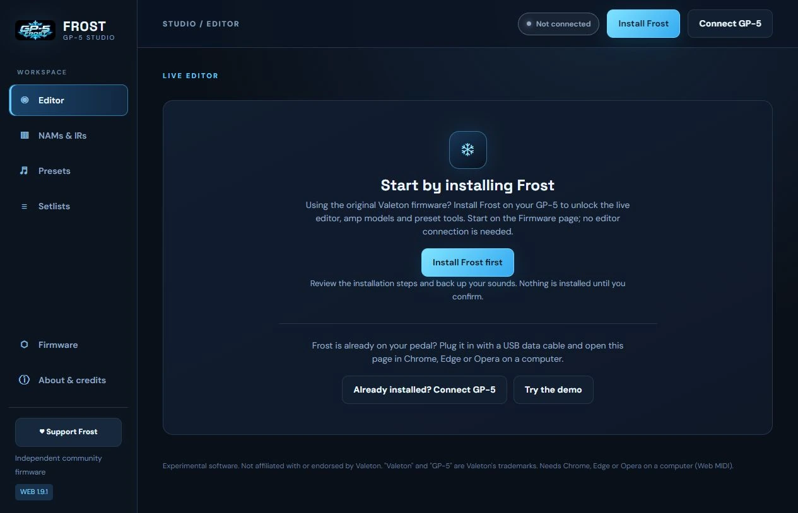
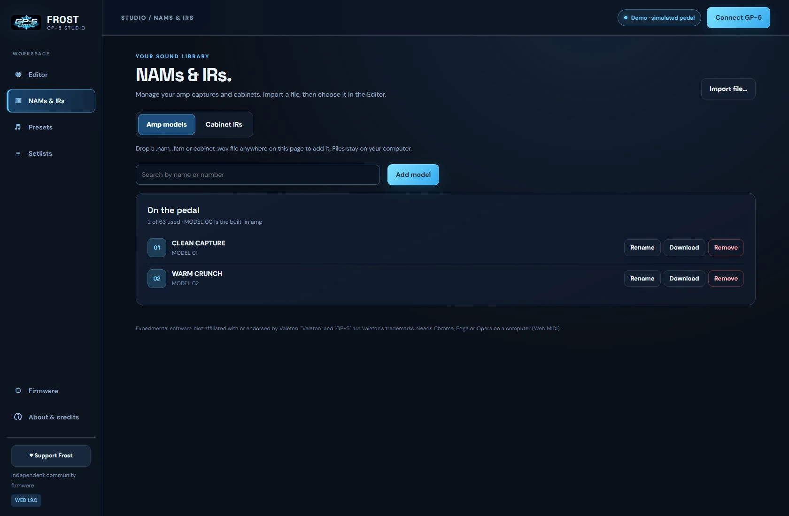
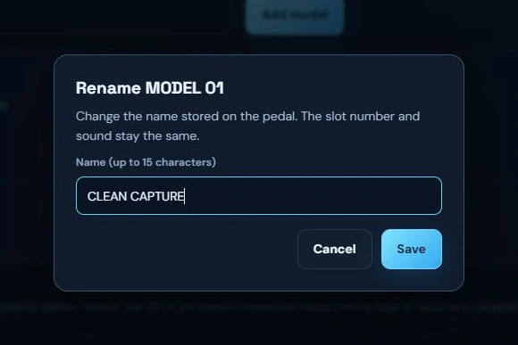
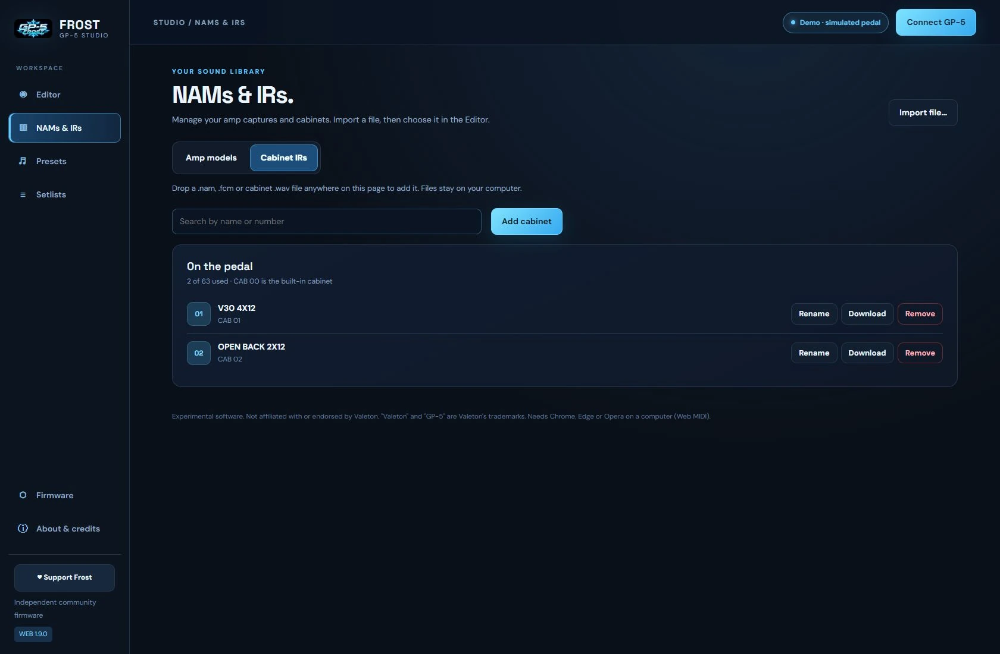

# Website Guide

[Frost Studio](https://freelender.github.io/frost-gp5/) is the companion editor
for the GP-5. It manages the pedal through USB-MIDI. The pedal can play its
saved presets and setlist without a browser connected.

Screenshots show the current local website source. The Editor and library
images use a documentation demo with synthetic preset, model and cabinet
names; these sample stored files are not part of **Try the demo**. No private
captures or pedal data are shown.

## Connect or try the demo

1. Use desktop Chrome or Edge. Power the pedal and connect a USB data cable.
2. Close other editors and tabs connected to the GP-5.
3. Open Frost Studio, click **Connect GP-5** and allow MIDI/SysEx access.
4. Wait until the connection status shows the pedal is connected.

The status bar distinguishes disconnected, connecting, connected, busy, demo
and error states. During file transfers, wait for the operation to finish
before editing or starting another transfer. If USB disconnects, reconnect
and read the pedal again. Hard reload with Ctrl+Shift+R after a website update.

**Try the demo** opens a simulated live editor without writing a real pedal.
It is useful for exploring the interface, not for judging the sound or testing
real hardware compatibility. Use the connection control to disconnect when
finished. Listen through the GP-5's normal audio output; this editor is not a
USB audio recorder. The release firmware includes USB audio and BLE MIDI,
as described in the [build guide](Build%20Firmware.md);
recording and playback use a computer audio application. BLE MIDI does not
stream phone audio.

 Frost Studio before connecting: Connect GP-5 or Try the demo

## Find your way around

The main navigation has **Editor**, **NAMs & IRs**, **Presets** and
**Setlists**. Firmware and About are grouped below these everyday tools.
NAMs & IRs combines captures and cabinets in one library; use its
**Amp models / Cabinet IRs** switch to choose which list to manage.

The **EN | PT** switch beside the status chooses the interface language
(English or Brazilian Portuguese). It starts in your browser's language and is
remembered in this browser. Effect and knob names, the pedal's menu words and
the names you store stay as the pedal shows them.

## Editor

 Editor: preset selector, named NAM model and effect controls (documentation demo)

The preset selector is the main control at the top left of the Editor, above
the signal chain. Its **◀ ▶** arrows load the previous or next
stored preset; between them is the preset now playing. Click its name to open
a list of every stored preset with a search box (name or number); one click
loads a preset, and ↑/↓, Enter and Esc work from the keyboard. Like **Load**,
the arrows and the list ask first when you have unsaved changes from this page.

The chain strip shows the six slots in input-to-output order. Click a block
to select it; the inspector below shows its controls. Left/right keyboard
arrows also move the selection between blocks.

To change the order, **drag a block** onto another position. The other blocks
keep their order and every block keeps its settings. On a touch screen or with
the keyboard, use the inspector's **◀ ▶** buttons or **Alt + ←/→**. Reordering
needs Frost 32p or later; like every live edit it is not saved until you save
a preset.

### Choose and edit an effect

1. Select a block.
   Its right-aligned **Replace effect** button opens the Effects library;
   an empty slot shows **Add Effect** instead.
2. In the **Effects library** on the right, search or pick a category, then
   click an effect to load it into the selected block. You can also **drag an
   effect** from the library onto any block.
3. A newly chosen effect starts off. Use its switch to enable it.
4. Turn its knobs: drag up or down, or scroll on a knob (hold Shift for fine
   steps); double-click a knob for its default; the arrow keys also work on a
   focused knob. Labelled choices are drop-downs. Changes play immediately.
5. Use **Remove** to clear the block after confirming.

The pedal can refuse an unsupported combination, such as a second amp or a
resource configuration it cannot accept; the previous block then remains.
When it refuses an effect because the chain would overload the audio processor,
the page shows the same **DSP LIMIT** popup as the pedal's screen (or **CHAIN
TOO BIG** when the effects do not fit its effect memory). Remove an effect or
choose a lighter one. The popup is included in the initial Frost 0.1.0 preview.
Six visible slots do not guarantee that every heavy chain fits the DSP budget.
See the [Effects list](Effects%20list.md) for every effect and its controls,
and the [User Guide](User%20Guide.md) for pedal-side position changes.

### Capture model selector

The **NAM FCM CAPTURE** block has a **MODEL** dropdown showing each position's
number and stored model name in a compact selector above its knobs.
MODEL 00 is the built-in default; empty positions
are marked **Empty — default fallback**. Choosing a model changes the live
sound immediately. Save the preset to keep the selection.
Choose **Add a model…** at the end of the dropdown to open the library's
import form for this block.

### Cabinet selector

An IR block has an additional **CAB** selector. CAB 00 is built in; 01–63
refer to imported cabinets. The status explains whether the cabinet is loading,
missing or globally bypassed. An empty/missing custom cabinet uses the built-in
fallback. Uploading a cabinet does not select it automatically.
Choose **Add a cabinet…** in the CAB dropdown to import one for this block.

### Save your live sound

Live edits change the current sound but are **not stored in a preset**.
To keep them from the website (Frost 32p or later):

1. In **Live vs saved**, choose **Save as preset**: a preset number. It starts
   on the preset currently loaded; numbers marked *(replace)* are in use.
2. Enter a **Name** (up to 16 characters) and click **Save to pedal**.
3. Confirm. The pedal saves the sound exactly as its own PRESETS → SAVE does.

On the pedal: press PARA on a selected block, open **PRESETS**, choose the
destination number, then **SAVE**. Saving to an occupied number replaces it.

Changing presets or switching off before saving discards live edits. A backup
contains stored data, not unsaved live settings.

## NAMs & IRs

 Amp models: search stored names or numbers, add a file, or manage an existing model (documentation demo)

The library starts with your stored files and a search by name or number.
Click **Add model** or **Add cabinet** to open an import form; **Close** hides
the form and keeps its draft. You can also choose **Import file…** or drop a
file on the page: `.nam` and `.fcm` open Amp models, and `.wav` opens Cabinet
IRs. Training audio is chosen separately inside the NAM conversion form.
Older links to the separate AMP models and Cabinet IRs pages still open the
matching library view.

### Rename a stored model or cabinet

1. Choose **Amp models** or **Cabinet IRs**, then find the stored file by name
   or number.
2. Click that row's **Rename**. The window starts with the current name.
3. Enter a name of up to 15 characters: letters, numbers, spaces and standard
   punctuation. A blank name cannot be saved; outside spaces are trimmed.
4. Choose **Save** to write the name to the pedal, or **Cancel** / Esc to keep
   the old name. Enter also saves. Saving an unchanged name does not rewrite it.

The model/cabinet stays at the same number with the same audio data, so
presets keep referencing it. Names in the Editor and library refresh after
saving. Storage writes can briefly interrupt audio.

 Rename starts with the stored name; Save writes it and Cancel leaves it unchanged

### Use an uploaded file

After writing, **Open Editor** returns to your sound. If you started from a
NAM or IR block, **Use in this block** selects the uploaded file in that block.
It does not turn the block on or save the preset. Save the preset when ready.

### AMP models

This page converts supported **NAM A2 WaveNet** captures to Frost FCM models
and writes ready-made `.fcm` files. Unsupported architectures/layouts are
rejected. The resulting sound is an approximation of the capture; Frost does
not run native NAM on the pedal.

#### Convert a capture

1. Open **NAMs & IRs → Amp models → Add model**, then drop a supported
   `.nam` into the model box or choose it from your computer.
2. Set a name (up to 15 characters) and destination **MODEL** number.
3. Optionally choose the recommended training `input.wav` described by the
   page. **Clear** removes that optional audio selection.
4. Click **Convert** and wait for the progress display. Conversion can take
   several minutes. Keep the tab open; **Cancel** stops conversion.
5. Review the completion message. Optionally click **Download .fcm** (shown
   only after a conversion finishes) to keep the converted model as a file;
   it can be written to any Frost pedal later without converting again.
   Then click **Write to pedal** and confirm the destination. Wait for the
   transfer to finish.
6. Choose **Use in this block** when offered, or select the matching MODEL in
   the Editor's or pedal's **NAM** block. Save the preset.

Conversion runs in browser workers; the selected capture is not uploaded to a
conversion server. A ready-made `.fcm` does not need NAM conversion: select
it, choose its destination and write it when the page enables that action.

MODEL 00 provides the built-in/default behavior; user model positions are
01–63. The **On the pedal** list shows stored models. **Download** saves a
stored model as an `.fcm` file, for example to move it to another pedal or
keep it before replacing it. **Remove** deletes the selected file after
confirmation. Presets reference numbers: replacing or
removing a model affects every preset using that number. A missing model
uses the default rather than restoring the deleted capture.

### Cabinet IRs

 Cabinet IRs uses the same search, import and management layout (documentation demo)

1. Open **NAMs & IRs → Cabinet IRs → Add cabinet**, then drop a cabinet
   `.wav` into the import box.
2. Read the parsed-file information, enter a name (up to 15 characters) and
   choose **CAB 01–63**.
3. Click **Write to pedal**, confirm any replacement and wait.
4. Choose **Use in this block** when offered, or select an IR block in the
   Editor and choose that CAB number. Enable
   the block and save the preset on the pedal.

The importer accepts supported WAV sample formats/rates and mono/stereo
input, converts to mono 44.1 kHz and prepares a 512-tap cabinet response.
This is for short cabinet responses, not preserving long room/reverb tails.
CAB 00 remains built in and is not a writable user position.

The stored list offers **Rename**, **Download** and **Remove**. **Download** saves the
cabinet as it is stored on the pedal: a mono 44.1 kHz, 32-bit float `.wav`
of 512 samples. Importing that file again gives the same cabinet; it is not
the original, longer WAV. Replacing a CAB changes every preset
referencing it; deleting it leaves those references with built-in fallback.
If a cabinet seems bypassed, check the block switch and the pedal's Global
**CAB OVERRIDE** setting.

## Presets

The list shows saved pedal presets, not a separate browser preset bank. Type
in the search box above it to show only the presets whose name or number
matches. The preset now playing is marked "playing now".

- **Load:** play that saved preset. Unsaved live edits are replaced; the page
  asks first when it knows you edited from this page. It waits for recall to
  finish and refreshes the chain. Close the tuner and finish file transfers
  first. Edits made only on the pedal
  cannot be detected reliably by the page's unsaved-edit indicator.
- **Rename:** enter the new name (up to 16 characters) and confirm.
- **Up/down:** swap a preset with the number above or below it. The list
  changes at once; the pedal follows in about a second.
- **Delete:** remove that stored preset after confirmation.
- **Download:** save that preset as a `.frostpreset` file, for sharing or
  keeping single sounds. The file also contains the AMP models (NAM) and
  cabinet IRs the preset plays, so it is complete on another pedal.

A preset file holds the chain, order and every setting, plus a copy of each
user AMP model and cabinet it uses (as stored on the pedal: the converted
model and the prepared 512-tap cabinet, not the original `.nam` or `.wav`).
The built-in MODEL 00 and CAB 00 are not included.

To **import** a preset file, choose the destination in **Import into**, then
**Import preset** and the file. Importing to a used number replaces that preset
after confirmation. When the file contains AMP models or cabinets, the same
window asks where to store each one, with a list of MODEL or CAB 01–63 that
shows what each number holds now:

- **already here:** this number holds the identical file. It is not written
  again; the preset simply uses it. This is chosen automatically when found.
- **empty:** the file is written there. Its original number is suggested if
  empty, otherwise the first empty number.
- **replace:** the stored file is overwritten. Every preset that uses that
  number changes sound, so choose this only on purpose.

The preset is renumbered to play the files from the numbers you chose. The
files are written first and the preset last; if a file cannot be written, the
preset is not imported. Two files of the same kind cannot share a number.

Preset files from older website versions contain no AMP models or cabinets.
They import as before: the preset uses whatever this pedal has at its MODEL
and CAB numbers, or the built-in cabinet and default model when those numbers
are empty. The import window lists such numbers. A preset with three or more
IR blocks keeps its cabinet choice only for the first two, as on the pedal.

Song parts reference preset numbers. Reordering, replacing or deleting a
preset changes what those parts play. Check your setlist after reorganizing.
To save live edits, use **Save to pedal** in the Live editor, or the on-pedal
controls described in the [User Guide](User%20Guide.md). MIDI controllers can also recall patches and
control every effect: see [MIDI commands](Midi%20Command.md).

### Back up everything

Click **Back up everything** and keep the downloaded `.frostbackup` file.
It contains stored presets, AMP models, IRs, global settings and songs/setlist.
Use a dated backup before firmware updates or large reorganizations.

### Restore backup

Choose **Restore backup**, select a Frost backup and read the confirmation.
Restore replaces pedal data with the backup's contents; back up the current
state first. Wait for completion and restart after restoring global preferences.
A Frost backup is neither a firmware image nor a Valeton preset backup.

## Songs & setlist

There are two separate things: a **song library** of named parts and a
**performance order** that arranges songs on the pedal.

1. Save the presets your parts will use.
2. Open **Setlists**. To preserve an existing pedal library, start with
   **Read from pedal**. Confirm only if you want to replace the browser draft.
3. Click **New song**, enter its name and name its first part.
4. Choose a saved preset number for each part. **Add part** creates another
   part; the up/down controls reorder parts and **Remove** removes one.
5. Click **Add to setlist**. A library song alone is not in performance order.
6. Name the setlist. Use its up/down controls to arrange the performance order.
   **Remove** here removes an order entry, while **Delete song** removes the
   library song and its entries. A song can appear in the order more than once.
7. In the **Setlist** panel click **Save setlist to pedal**, confirm and wait
   for the display to refresh.
8. On the pedal choose GLOBAL SETTINGS → **DISPLAY → HOME SCREEN → SETLIST**, then **BACK** to save.

**Remove setlist from pedal** (in the Setlist panel) deletes the songs and
setlist stored on the pedal after confirmation; its Setlist home screen then
shows NO SETLIST. Presets and global settings are kept, and the browser draft
stays so you can save it again.

**Export songs** saves the browser library/order as JSON. **Import songs**
replaces the browser draft after validation/confirmation; it does not write
the pedal until you choose Save setlist to pedal. Drafts also persist in this browser's
local storage. Other browsers/computers have separate drafts.

Limits: up to 64 library songs, 16 parts per song and 64 performance entries,
subject to the shared byte limit shown on the page. Use the usage indicator
and validation message when a large library does not fit. There is one active
setlist on the pedal; exported JSON files can keep alternatives.

## Firmware

Use this page to select a local `.bin`, review its identity/sections and
confirm installation. A bundled Install Frost button is available only when
that site copy includes a firmware download. The installer also accepts the
correct official Valeton image you supply for restoring stock firmware.

Follow the [Installation Guide](Installation%20Guide.MD) for backups,
installation, verification and recovery. Keep power/USB connected until the
operation finishes; the progress log reports section writes and restart.

## About

The About page describes Frost, credits the project it builds on and provides
the Ko-fi support link (ko-fi.com/freelender). It does not change pedal data.

## Quick troubleshooting

| Symptom | Action |
|---|---|
| Connect fails | Check desktop browser, data cable, MIDI/SysEx permission and competing editors |
| Controls disabled | Connect the pedal and wait for any current transfer |
| Edits disappear | Use Editor → Save to pedal, or PRESETS → destination → SAVE on the pedal |
| Model conversion rejected | Check that the capture is a supported NAM A2 layout |
| Uploaded cabinet not heard | Select its CAB in IR, enable the block, disable CAB OVERRIDE |
| NO SETLIST on the pedal | Add songs to performance order and Save to pedal |
| Unexpected cached behavior | Hard reload and reconnect |

Storage writes can briefly interrupt sound. Prepare files and settings before
performance; preset/part recall is the performance workflow.

MODEL and CAB storage writes, including renames, retry temporarily refused
flash erase/program requests up to eight attempts with short delays.
Data is read back before committing the new
file. If an upload still reports `program failed at 0x...` or `erase failed`,
keep the full error and firmware version for a bug report. During replacement,
the previous stored copy is retained until the new data and header are verified.

## Publish and deploy this editor

The maintainer's release and GitHub Pages steps are in
[Build Firmware → Publish the initial preview and deploy GitHub Pages](Build%20Firmware.md#10-publish-the-initial-preview-and-deploy-github-pages).
The manual Pages workflow can bundle the single verified release image by
its GitHub tag, enabling **Install Frost**. Selecting a local `.bin` remains
available. Website deployment does not update a connected pedal.
